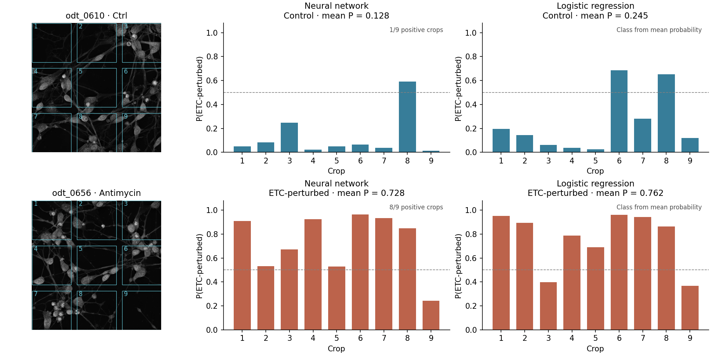

# OARL-NET

Official code repository for:

**Organelle-Aware Representation Learning Enables Label-Free Detection of
Mitochondrial Perturbation in Live Human Neurons**

SeungJu Yoo\*, Eunjin Yang\*, Jeonghyun Kim, Seo-Hyun Kim, Hoewon Park,
Daesoo Kim, Ki-Jun Yoon, and Minee L. Choi

Accepted for publication in *Smart Medicine*. \*Equal contribution.

[Preprint](https://doi.org/10.1101/2025.10.12.681848) ·
[Data](https://doi.org/10.5281/zenodo.24082917) ·
[Examples](#example-notebooks) ·
[Citation](#citation)

OARL-NET learns organelle representations from optical diffraction tomography
(ODT) to detect mitochondrial perturbation in live neurons. Two classification
approaches distinguish control neurons from neurons treated with ETC inhibitors:
a neural network using learned encoder features, and logistic regression using
descriptors of predicted organelle masks. Fluorescence supplies segmentation
targets during training; both classifiers use ODT alone at inference.

| Application | Workflow | Example |
|---|---|---|
| Neural-network classification | ODT → OARL encoder → neural classifier | [Notebook](examples/classification_neural_network.ipynb) |
| Logistic-regression classification | ODT → organelle masks → 30 descriptors → logistic classifier | [Notebook](examples/classification_logistic_regression.ipynb) |
| Organelle segmentation | ODT → nucleus, lysosome and mitochondria maps | [Notebook](examples/inference.ipynb) |



The classification notebooks use the same two test tomograms: the first control
and the first ETC-treated sample in manifest order. Bars show crop probabilities;
the titles give the tomogram predictions. These examples illustrate inference.
See [classification methods and feature definitions](docs/classification.md)
for the two models and their aggregation rules.

This repository includes model weights, training and inference scripts, dataset
split metadata, and notebooks with saved example outputs.

## Installation

Use Python 3.12. Clone the repository and install the dependencies:

```bash
git clone https://github.com/SeungJuYoo-1/OARL.git
cd OARL
python3.12 -m venv .venv
source .venv/bin/activate
python -m pip install -r requirements.txt
```

The requirements use PyTorch 2.11 and torchvision 0.26. For a CPU build or a
different CUDA build, install those versions using the
[PyTorch instructions](https://pytorch.org/get-started/locally/) before installing
the remaining requirements. Inference supports CPU and CUDA; training benefits
from a CUDA GPU.

## Data and model weights

The datasets are available on [Zenodo](https://doi.org/10.5281/zenodo.24082917).
The two archives match the supplied [tomogram manifest](metadata/tomograms.csv).

| Resource | Contents | Download |
|---|---|---|
| Classification dataset | 1,018 tomograms: control and three ETC inhibitor conditions | [11.37 GB](https://zenodo.org/api/records/24082917/files/classification_dataset.zip/content) |
| Segmentation supplement | 604 additional tomograms for organelle segmentation | [7.21 GB](https://zenodo.org/api/records/24082917/files/segmentation_supplement.zip/content) |
| Model weights | `segmentation.pth` and `classification.pth` | [Download weights](https://github.com/SeungJuYoo-1/OARL/releases/download/v1.0.0/oarl-net-weights.zip) |
| Logistic classifier | Standardization parameters, 30 coefficients and intercept | [Included JSON](checkpoints/logistic_regression.json) |

Together, the two datasets contain 1,622 tomograms. Data and PyTorch weights are
distributed separately from the source code; the small logistic model is included
in the repository. Use the following layout:

```text
OARL/
    checkpoints/
        segmentation.pth
        classification.pth
        logistic_regression.json
    examples/
    metadata/tomograms.csv
    oarl_net/
classification_dataset/
    Ctrl/odt_.../
    Antimycin/odt_.../
    Oligomycin/odt_.../
    Rotenone/odt_.../
segmentation_supplement/
    odt_.../
```

See [data format and preprocessing](docs/data.md) for image dimensions, RI
scaling and fluorescence channels. [Manifest documentation](metadata/README.md)
describes the labels, groups and split assignments.
[Checkpoint documentation](checkpoints/README.md) lists file sizes and checksums.

Extract `oarl-net-weights.zip` from the directory containing the cloned `OARL/`
folder. The archive places both weights in `OARL/checkpoints/`. From `OARL/`,
check that the models load and run:

```bash
python smoke_test.py
```

## Example notebooks

All three notebooks include output plots that can be viewed on GitHub.

| Notebook | Contents | Required weights |
|---|---|---|
| [Neural-network classification](examples/classification_neural_network.ipynb) | Load two tomograms, predict nine crops per tomogram, combine votes and save predictions | `classification.pth` |
| [Logistic-regression classification](examples/classification_logistic_regression.ipynb) | Predict masks, extract 30 descriptors, apply the logistic model, inspect coefficients and save predictions/features | `segmentation.pth` and the included `logistic_regression.json` |
| [Segmentation and inference](examples/inference.ipynb) | Predict full-field organelle maps and a neural classification for one tomogram | Both `.pth` files |

After preparing the classification dataset and weights, install the notebook
dependencies and open the examples:

```bash
python -m pip install -r requirements-notebooks.txt
python -m jupyter lab examples/
```

Set `DATA_DIR` in each notebook to your dataset location. The notebooks use CUDA
when available and otherwise run on CPU. The segmentation supplement is not
needed for these examples.

## Command-line inference

Classify one tomogram from the classification test split with the neural network:

```bash
python predict_classification.py \
    --data-dir ../classification_dataset \
    --split test --limit 1 \
    --output predictions/classification.csv
```

The CSV contains one row per tomogram. `prediction` is 1 (ETC-perturbed) when at
least five of the nine crops have probability above 0.5; otherwise it is 0
(control). `tomogram_probability` is the mean of the nine crop probabilities,
used as a continuous score for ROC analysis. `--threshold` changes the crop
probability threshold used in the vote.

Classify one tomogram with logistic regression on predicted-mask descriptors:

```bash
python predict_logistic_regression.py \
    --data-dir ../classification_dataset \
    --split test --limit 1 \
    --output predictions/logistic_regression.csv
```

This script loads `segmentation.pth` to predict the organelle masks and
`logistic_regression.json` to classify their descriptors. Its CSV has the same
columns as the neural classifier output. The logistic classifier assigns class 1
when the **mean** of the nine crop probabilities exceeds 0.5.

Predict organelle maps for one tomogram from the segmentation test split:

```bash
python predict_segmentation.py \
    --data-dir ../classification_dataset \
    --supplement-dir ../segmentation_supplement \
    --split test --limit 1 \
    --output predictions/segmentation
```

Each output `.npz` contains `probabilities`, a `(3, 741, 741)` float16 array in
nucleus, lysosome, mitochondria order. Predictions from overlapping 224 x 224
tiles are averaged. Threshold the maps at 0.5 to obtain binary masks.

Remove `--limit 1` to process the selected split. All three scripts also accept
`--split all`, `--checkpoint PATH` and `--device cpu`. For segmentation and
logistic regression, `--batch-size` controls the number of crops or tiles
processed together; reduce it if memory is limited. The logistic script accepts
`--segmentation-checkpoint PATH` separately. Use `--help` to see all options.

## Training

Train the segmentation model:

```bash
python train_segmentation.py \
    --data-dir ../classification_dataset \
    --supplement-dir ../segmentation_supplement
```

The default is up to 500 epochs with batch size 8, AdamW learning rate 2e-4,
and early stopping after 30 epochs without validation-loss improvement.
The best model is saved to `training_output_segmentation/best_model.pth`.

Train the classifier using that encoder:

```bash
python train_classification.py \
    --data-dir ../classification_dataset \
    --encoder training_output_segmentation/best_model.pth
```

The classifier trains for 200 epochs with batch size 32 and learning rate 1e-3.
Encoder parameters are frozen by default; BatchNorm running statistics continue
to update during training. `--no-freeze` enables end-to-end fine-tuning. The model
with the best validation tomogram AUROC is saved to
`training_output_classification/best_model.pth`. Pass that path with
`--checkpoint` when running inference on the trained classifier.

Both training scripts accept `--epochs`, `--batch-size`, `--learning-rate`,
`--num-workers` and `--seed`. They load the selected tomograms into RAM before
training. Configuration defaults are in [oarl_net/config.py](oarl_net/config.py).

## Citation

Please cite the paper above when using this code or the associated data.
Citation metadata is provided in [CITATION.cff](CITATION.cff). The journal DOI
and final publication details will be added when available.

## Questions

For code questions or bug reports, open a
[GitHub issue](https://github.com/SeungJuYoo-1/OARL/issues).
