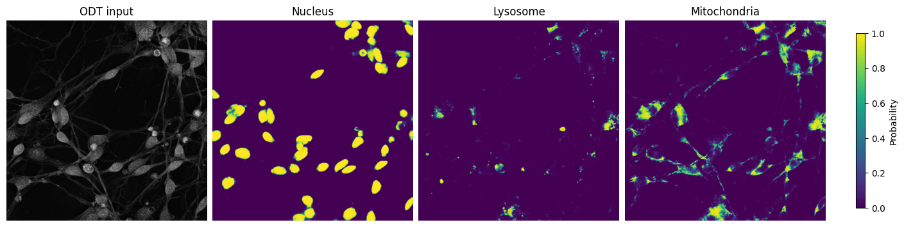

# OARL-NET

Official code repository for:

**Organelle-Aware Representation Learning Enables Label-Free Detection of
Mitochondrial Perturbation in Live Human Neurons**

SeungJu Yoo\*, Eunjin Yang\*, Jeonghyun Kim, Seo-Hyun Kim, Hoewon Park,
Daesoo Kim, Ki-Jun Yoon, and Minee L. Choi

Accepted for publication in *Smart Medicine*. \*Equal contribution.

[Preprint](https://doi.org/10.1101/2025.10.12.681848) ·
[Data preview](https://doi.org/10.5281/zenodo.17115497) ·
[Example notebook](examples/inference.ipynb) ·
[Citation](#citation)

OARL-NET predicts nucleus, lysosome and mitochondria masks from optical diffraction
tomograms. A classifier trained on the segmentation encoder distinguishes control
neurons from neurons treated with ETC inhibitors. Fluorescence provides the
segmentation targets during training; inference uses ODT alone.

This repository provides the segmentation and neural classification models,
training and inference scripts, dataset split metadata, and an example notebook.



ODT input and organelle predictions from the [example notebook](examples/inference.ipynb).

## Installation

Use Python 3.12. Clone the repository and install the dependencies:

```bash
git clone https://github.com/SeungJuYoo-1/OARL.git
cd OARL
python3.12 -m venv .venv
source .venv/bin/activate
python -m pip install -r requirements.txt
```

The requirements use PyTorch 2.11 and torchvision 0.26. For a CPU build or a
different CUDA build, install those versions using the
[PyTorch instructions](https://pytorch.org/get-started/locally/) before installing
the remaining requirements. Inference supports CPU and CUDA; training benefits
from a CUDA GPU.

## Data and model weights

The [Zenodo record](https://doi.org/10.5281/zenodo.17115497) contains a dataset
preview. The commands below use the full archives matching the supplied
[tomogram manifest](metadata/tomograms.csv).

| Resource | Contents | Availability |
|---|---|---|
| Classification dataset | 1,018 tomograms: control and three ETC inhibitor conditions | Full archive pending |
| Segmentation supplement | 604 additional tomograms for organelle segmentation | Full archive pending |
| Model weights | `segmentation.pth` and `classification.pth` | [Download weights](https://github.com/SeungJuYoo-1/OARL/releases/download/v1.0.0/oarl-net-weights.zip) |

Together, the two datasets contain 1,622 tomograms. Data and weights are
distributed separately from the source code. Use the following layout:

```text
OARL/
    checkpoints/
        segmentation.pth
        classification.pth
    examples/inference.ipynb
    metadata/tomograms.csv
    oarl_net/
classification_dataset/
    Ctrl/odt_.../
    Antimycin/odt_.../
    Oligomycin/odt_.../
    Rotenone/odt_.../
segmentation_supplement/
    odt_.../
```

See [data format and preprocessing](docs/data.md) for image dimensions, RI
scaling and fluorescence channels. [Manifest documentation](metadata/README.md)
describes the labels, groups and split assignments.
[Checkpoint documentation](checkpoints/README.md) lists file sizes and checksums.

Extract `oarl-net-weights.zip` from the directory containing the cloned `OARL/`
folder. The archive places both weights in `OARL/checkpoints/`. From `OARL/`,
check that the models load and run:

```bash
python smoke_test.py
```

## Example notebook

[examples/inference.ipynb](examples/inference.ipynb) walks through one tomogram:
loading the ODT input, predicting organelle maps, classifying nine crops, and
saving the results. It includes output plots that can be viewed on GitHub.
To run it locally after preparing the classification dataset and weights:

```bash
python -m pip install -r requirements-notebooks.txt
python -m jupyter lab examples/inference.ipynb
```

Set `DATA_DIR` in the notebook to your dataset location. The notebook uses CUDA
when available and otherwise runs on CPU.

## Command-line inference

Classify one tomogram from the classification test split:

```bash
python predict_classification.py \
    --data-dir ../classification_dataset \
    --split test --limit 1 \
    --output predictions/classification.csv
```

The CSV contains one row per tomogram. `prediction` is 1 (ETC-perturbed) when at
least five of the nine crops have probability above 0.5; otherwise it is 0
(control). `tomogram_probability` is the mean of the nine crop probabilities,
used as a continuous score for ROC analysis. `--threshold` changes the crop
probability threshold used in the vote.

Predict organelle maps for one tomogram from the segmentation test split:

```bash
python predict_segmentation.py \
    --data-dir ../classification_dataset \
    --supplement-dir ../segmentation_supplement \
    --split test --limit 1 \
    --output predictions/segmentation
```

Each output `.npz` contains `probabilities`, a `(3, 741, 741)` float16 array in
nucleus, lysosome, mitochondria order. Predictions from overlapping 224 x 224
tiles are averaged. Threshold the maps at 0.5 to obtain binary masks.

Remove `--limit 1` to process the selected split. Both scripts also accept
`--split all`, `--checkpoint PATH` and `--device cpu`. For segmentation,
`--batch-size` controls the number of tiles processed together; reduce it if
memory is limited. Use `--help` to see all options.

## Training

Train the segmentation model:

```bash
python train_segmentation.py \
    --data-dir ../classification_dataset \
    --supplement-dir ../segmentation_supplement
```

The default is up to 500 epochs with batch size 8, AdamW learning rate 2e-4,
and early stopping after 30 epochs without validation-loss improvement.
The best model is saved to `training_output_segmentation/best_model.pth`.

Train the classifier using that encoder:

```bash
python train_classification.py \
    --data-dir ../classification_dataset \
    --encoder training_output_segmentation/best_model.pth
```

The classifier trains for 200 epochs with batch size 32 and learning rate 1e-3.
Encoder parameters are frozen by default; BatchNorm running statistics continue
to update during training. `--no-freeze` enables end-to-end fine-tuning. The model
with the best validation tomogram AUROC is saved to
`training_output_classification/best_model.pth`. Pass that path with
`--checkpoint` when running inference on the trained classifier.

Both training scripts accept `--epochs`, `--batch-size`, `--learning-rate`,
`--num-workers` and `--seed`. They load the selected tomograms into RAM before
training. Configuration defaults are in [oarl_net/config.py](oarl_net/config.py).

## Citation

Please cite the paper above when using this code or the associated data.
Citation metadata is provided in [CITATION.cff](CITATION.cff). The journal DOI
and final publication details will be added when available.

## Questions

For code questions or bug reports, open a
[GitHub issue](https://github.com/SeungJuYoo-1/OARL/issues).
